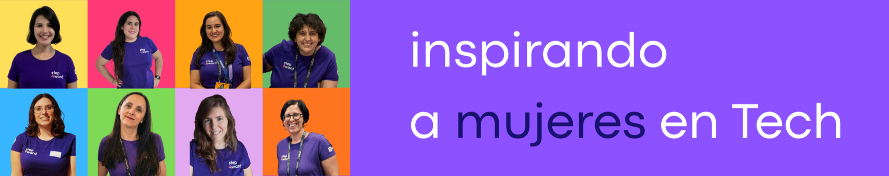

  

  

  
  
  
  
  
  

  

## Hola, somos Step4ward

Step4ward es un proyecto creado por mujeres, para mujeres, desde mayo de 2021. Somos un grupo de mentoras con experiencia en el sector tecnológico en España que ayudan a mujeres a comenzar o continuar su camino profesional en tech.

## Qué hacemos

<table>
  <tr>
    <td width="33%" valign="top">
      <h3>Mentorías</h3>
      Gratuitas e individuales con profesionales del sector: revisión de CV y LinkedIn, preparación de entrevistas y orientación profesional.
    </td>
    <td width="33%" valign="top">
      <h3>Eventos</h3>
      Step4ward Talks, Step4ward Labs y encuentros con la comunidad para aprender y conectar.
    </td>
    <td width="33%" valign="top">
      <h3>Recursos</h3>
      Cursos recomendados y grabaciones de nuestras charlas para tu desarrollo profesional.
    </td>
  </tr>
</table>

## Únete

  
  
  

  

